<div align="center">


# Smart Calendar

**A self-hosted planner that puts your tasks into your calendar, and moves them when your day changes.**

Automatic scheduling on your own server. Works with the calendars you already have: Google (two-way), Outlook/Exchange, Vikunja.

[**Try the live demo**](https://smart-calendar.git-demo.workers.dev) &nbsp;·&nbsp; [Features](#features) &nbsp;·&nbsp; [Mac menu bar app](#mac-menu-bar-app) &nbsp;·&nbsp; [Home Assistant](https://github.com/Esondor/ha-smart-calendar) &nbsp;·&nbsp; [Quick start](#quick-start)

    [](LICENSE.md)

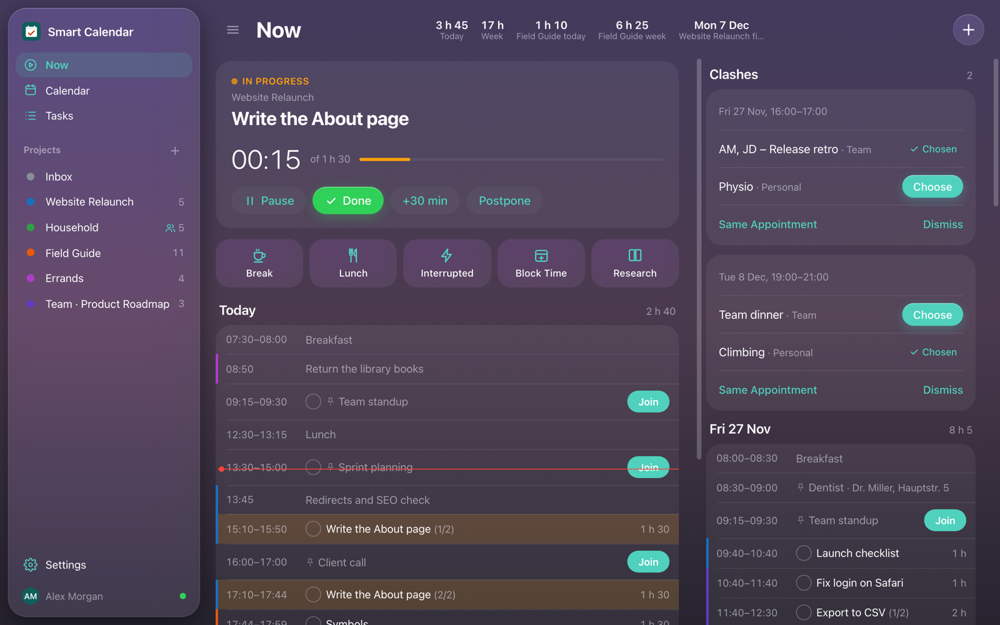

</div>

## What it does

Smart Calendar reads all your calendars (several Google accounts, Outlook/Exchange, Vikunja), knows your working hours, personal hours and breaks, and puts your tasks into the free time by priority and deadline. When the day changes, because a meeting runs over or you start something early, the flexible parts are planned again within seconds on every device.

The planned blocks are written into Google Calendar, so you can keep using Apple Calendar, Outlook or whatever app you like. Moving or deleting a block there is picked up by the server too.

It runs as one Docker container with one SQLite file on your own server. The web app installs from the browser on Mac, PC, iPhone and Android, with push notifications that also reach an Apple Watch.

You can try it without installing anything: the [live demo](https://smart-calendar.git-demo.workers.dev) runs in your browser with an invented week. Changes you make stay in your own browser tab and are gone after a reload.

<table>
<tr>
<td width="66%">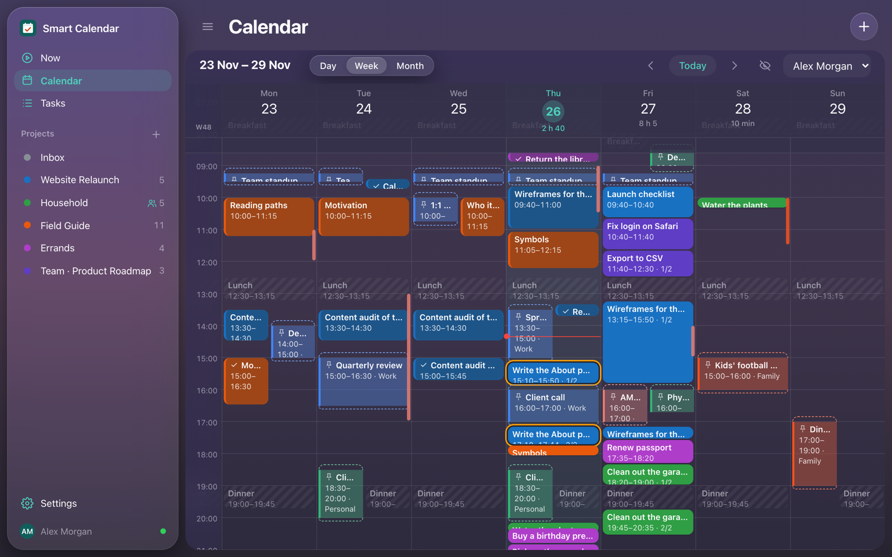</td>
<td width="34%" rowspan="2">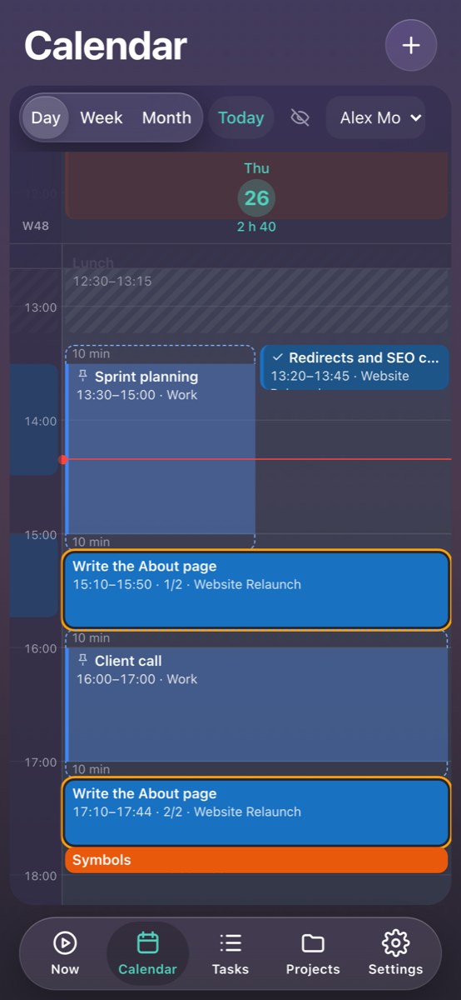</td>
</tr>
<tr>
<td>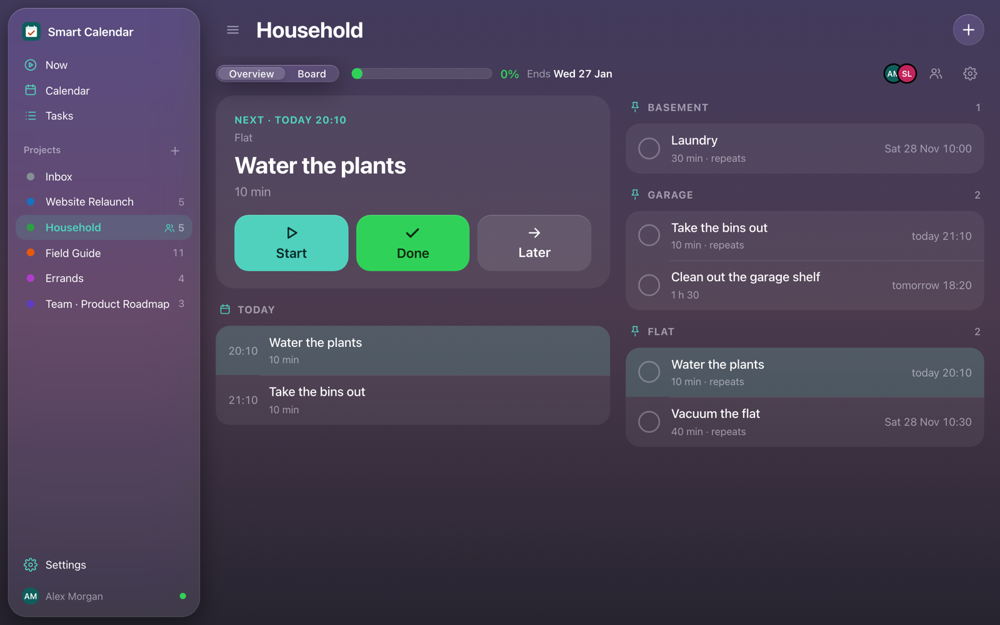</td>
</tr>
</table>

## Planning

Appointments that block time are respected, with a buffer before and after and the travel time when they are somewhere else. Tasks have a duration, a priority (ASAP, high, medium, low), an optional deadline and earliest start, and go into work hours or personal hours. Breaks can stay fixed or move a little to close a gap. The plan goes back into a calendar of your choice and is updated live.

## Shared calendars without the noise

A team or project calendar is mostly other people's appointments. For each calendar you set two lists of words: Mine (your initials, "Team") and Others (colleagues' names). Entries that concern you block your time and are shown, the rest is filtered out. The eye button in the calendar shows the filtered entries small or hides them again.

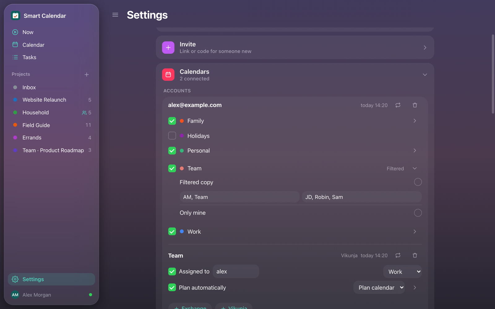

## Clashes

When a team appointment overlaps one of your own, Smart Calendar picks one: in working hours the work appointment, otherwise yours, and on a day off always yours. You get a push on your phone and Apple Watch and can change the choice with one tap. The appointment that loses gets a short note (`#AM-blocked`) in its calendar, so the others in a work or project calendar can see you won't be there. All clashes are listed on the Now page.

## Copies in several calendars

If an appointment is in several of your calendars (work, family, a project), Smart Calendar treats the copies as one: it is shown once with a dot for each calendar, is never counted as a clash with itself, and the copies are kept in step. A filtered copy writes only the entries that concern you from a busy calendar into another one, with a title prefix you choose.

## Projects and time tracking

Projects can be boards, shared household lists where chores take turns, or outlines for longer work such as a thesis, a book or a product, with chapters, sections, items, checklists and notes. Work sessions are tracked: start, pause and done from the app, the menu bar or a notification. The top of the Now page shows time spent today, this week and per project, and when each project will be finished at the current pace. Past sessions stay in the calendar, so you can see what you actually did.

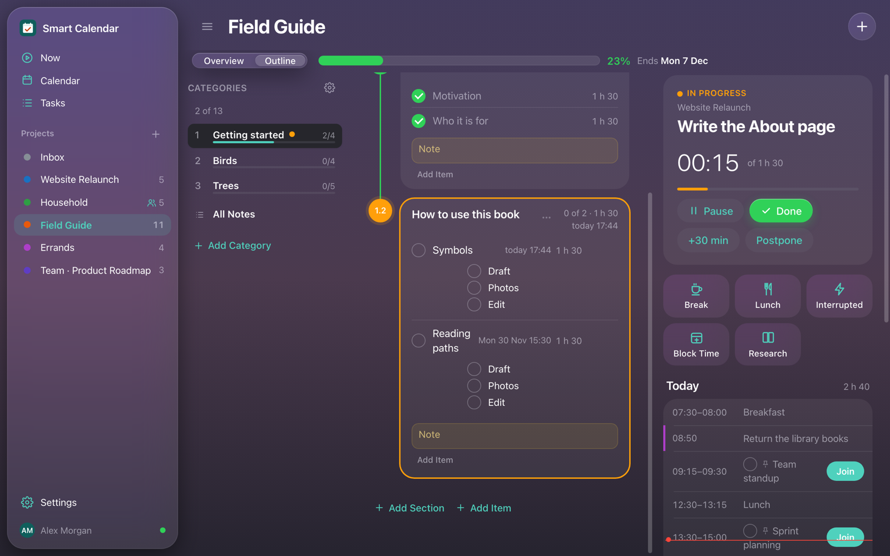

### Order

Long work is rarely done in the order it is read. The Order view sets the order a project is worked through, such as the writing order of a thesis: sections grouped into named phases, each with the work left and when it is planned. Drag a section to move it, or a phase to move all of it. The planner follows the new order right away, and new sections fall in after their neighbour in the outline.

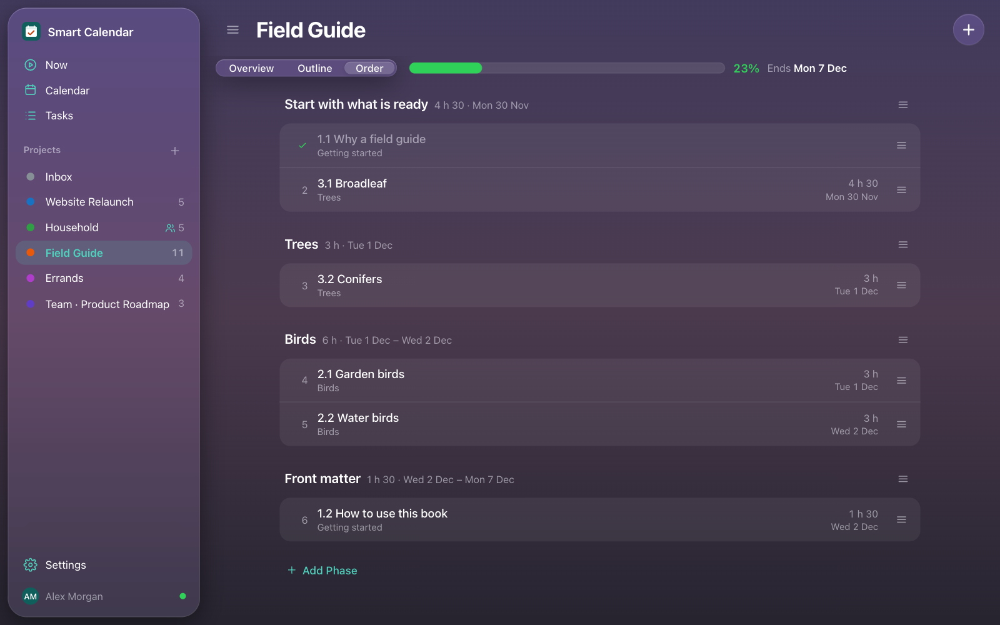

## Claude

Manage Smart Calendar from a chat with Claude (MCP). Describe a project and Claude creates it with its chapters, sections, tasks and estimates. Or attach a document, such as the current draft of a thesis, and Claude brings the outline in line with it: new sections, merged chapters, finished parts ticked off, estimates and deadlines adjusted. Claude can also rearrange the writing order. It lists every change first and applies them only after you agree, and the planner reschedules right away. The last batch can be undone. Each user turns it on for their own account and connects their own Claude account. Setup: [Claude](#claude-1).

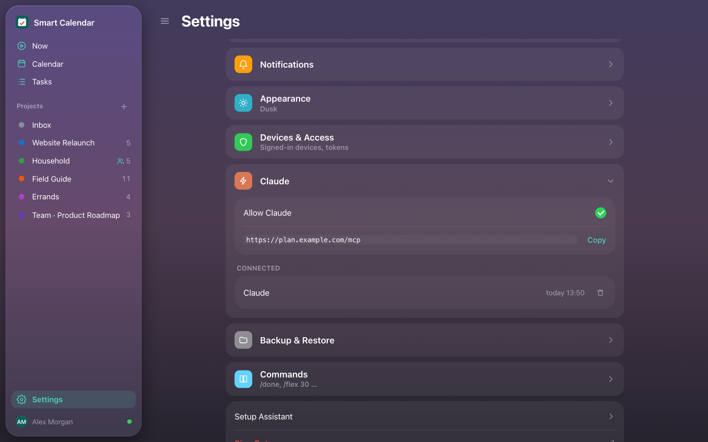

## Vikunja

Vikunja projects are synced through its API, only with the tasks assigned to you, and you choose per project whether they are synced and planned. Start moves a task to Doing in Vikunja's kanban and Done to Done. Files in a "Documents" bucket open in a side panel. A Vikunja behind an Authelia login works too.

## Notifications

Push (desktop, phone, Apple Watch), e-mail or both, set separately for task starts (with Start and Later buttons), appointments, deadlines, a morning summary, clashes and shared projects. A task that keeps getting moved reminds you at most three times a day.

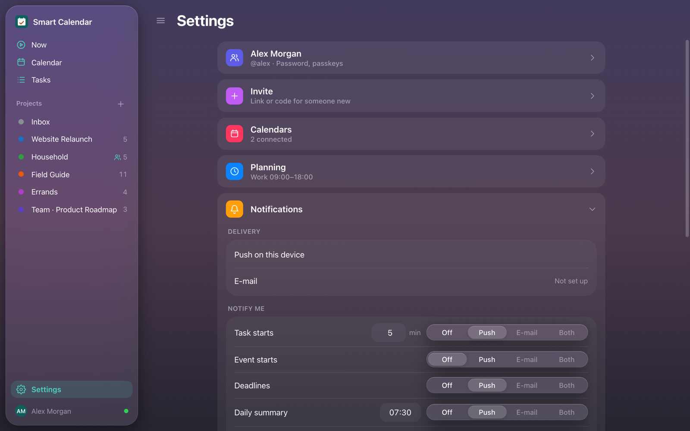

## Home Assistant and a tablet on the wall

The [Home Assistant integration](https://github.com/Esondor/ha-smart-calendar) (HACS) adds a Smart Calendar page to the Home Assistant sidebar, meant for a tablet in the kitchen or hallway. Everyone in the shared chores project taps their own button to see what is next for them, tick chores off, start them, push them to later or add a new one. It shows only that project, nothing else of anyone's calendar. Chores are grouped by place. The integration also brings sensors (next task, open tasks, waiting) and an event service, for example to create "empty the washing machine" when the washer is done.

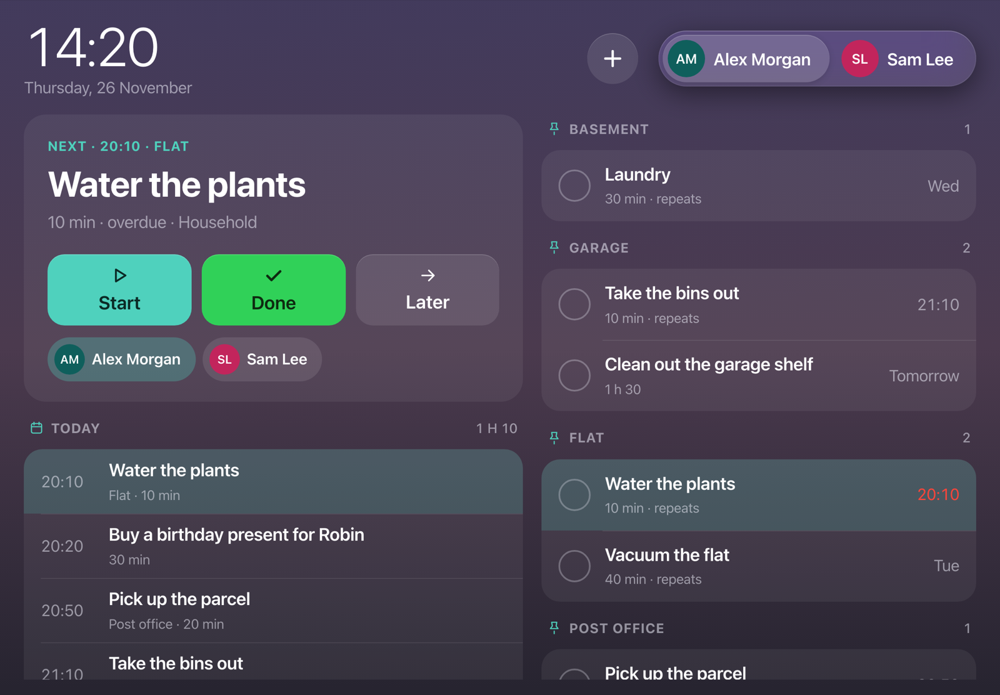

## Features

- **Auto-scheduling.** Tasks have a duration, priority, deadline, earliest start and minimum block size. The server fills them into your free time between Google, Exchange and fixed blocks, and re-plans after every change and every minute.
- **Chores that don't pile up.** Repeat a task daily, weekly or monthly, optionally every N days, on preferred weekdays or at a time of day. Each round is planned before it ends. A missed round doesn't stack up; it just makes the current round urgent. In shared projects you can **take turns**.
- **Shared projects (kanban).** Invite someone by their ID (shown in the Share dialog and in Settings): they get a push notification and accept or decline. Everyone sees the board, assigned tasks land in the assignee's own calendar, and partners get a push notification when something is done. The eye button shows when the others are planned to work on the project's tasks; their calendars stay private.
- **Focus and writing views.** The *Now* page (focus card, timer, Break, Lunch, Pulled away, Research, today's timeline, coming days, Later list, projected finish) and the *Writing* view (red thread → chapter → sections → sub-chapters with points) are built in.
- **Drag in the calendar.** With a mouse, drag anything you can change (blocks, your appointments, breaks, logged sessions) right away, or its top or bottom edge to change when it starts or ends; a click selects it, a second click opens it. By touch, tap it first to select it, then drag, so scrolling never moves anything by mistake. It stays where you drop it, even after several quick drags, and the rest of the plan moves around it. Dragging the session that's running sets when you started and when it should end; it then gets 30 more minutes each time that end is reached, until Done.
- **New.** The + button and a click on an empty spot in the calendar offer the same: Task, Appointment, Break / Block Time (from the calendar at the time clicked). A break shows like Lunch and a long task is planned around it.
- **Appointment.** One kind, everything in view. A switch slides between *Time* (at a time you give, written to the calendar you pick; all day, blocking or not) and *Planned* (Smart Calendar finds the time). Start and End / Due sit side by side; the start is now unless you change it, and the due date can have a time. Planned: how long it takes (− / +), in your work or personal hours, *All day* (all your hours together, never at night) or, checked, a certain time window (between times, on some days), and the priority it starts with. Calendar, place and notes for both.
- **Task.** Looks like an appointment: everything in one view, no extra options to open. Start (now for a new task) and Due side by side, each with a time if you like; how long (− / +); your work or personal hours, *All day* (all your hours together, never at night), or a certain time window; the priority it starts with; repeat, assignee, place, calendar, smallest block and follow-ups.
- **Priority rises by itself.** The priority you choose is where a task or appointment starts. As its end date comes near it rises step by step (three weeks out it starts, a week out it is High, with two days to spare ASAP), so it is planned earlier; a repeating chore rises the same way within each round. Close to ASAP it may take a loose break's place, and if its hours run out before the end date it goes on after them until your bedtime (Settings → Hours: Up from, Bedtime) rather than be late. Tasks in the calendar show it as color, green for Low through yellow and orange to red for ASAP; appointments keep their calendar's color with the priority at the edge. Ordered projects (a thesis, worked through in its order) keep their own color and priority. A line under the calendar shows what the colors mean.
- **All day.** All-day appointments show at the top of each day. A new one is Free unless you switch on *Blocks time*; any appointment's details can change that later. With non-blocking events minimised (the eye), all-day events that a calendar's filter says are not yours are left out.
- **Logged sessions** can be dragged and resized in the calendar to correct them; the task's time and the ✓ entry in Google follow.
- **Breaks in the calendar.** Tap a break, blocked time or a fixed break like Lunch to select it, then drag it or its edges; tap again for its time, title, Save and Remove. A fixed break changes only on that day (*Skip This Day* leaves it out, and the plan uses the time); for every day, change it in Settings. On a desktop, sideways scrolling (trackpad, a mouse's side wheel, Shift + wheel) moves further and settles on a day when you stop.
- **Google Calendar, two-way.** Planned blocks are written into a calendar of your choice, so they also show up in Apple Calendar through your Google account. Changes you make there come back:
  - **move** a block → it's pinned there and everything else is re-planned around it
  - **delete** it → postponed to the next free slot after it
  - type **`/done`** in its title or notes → done; it stays in the calendar as `✓ …` (starting the title with `✓` or `x` works too)
  - type **`/later`** → the block goes away and the task is planned again later; **`/skip`** skips this round of a repeating task (otherwise the same as `/later`)
  - the command is removed after it's processed, and a block never gets more than one `✓`
  - when you finish a task, its block stays in the calendar as `✓ …` (a log of what you did)
- **Exchange / Outlook** through the published ICS link (read-only). Your appointments block time.
- **Vikunja, two-way.** Open tasks assigned to you are planned. Done here closes them in Vikunja, and done there closes them here.
- **Live sync.** Google and Vikunja push every change to the server (Google push channels, Vikunja webhooks), which plans and updates every open app within seconds. Both are set up by the server itself; they need its public https address. Polling stays only as a fallback (Google: this week every 5 min, later hourly; Vikunja: every 15 min). Without push: Google every minute / 15 min, Vikunja every minute. ICS (Exchange) can't push: every 2 min, downloaded only when the feed changed. Settings → Calendars shows **Live** for pushed accounts.
- **Web app (PWA)** with push notifications. On iPhone: Safari → Share → *Add to Home Screen*, then turn on notifications in Settings.
- **Notifications by push, e-mail or both.** Settings → Notifications lists every notification the app sends: task starts (with Start / Later buttons), event starts, deadlines, the daily summary, clashes, shared projects, follow-ups ready, and connection problems. Each one is set to Off, Push, E-mail or Both. Push is the default; clashes go by push and e-mail. E-mail needs the admin's SMTP setup (Administration → Server → E-mail) and your address; until then everything goes by push.
- **Order.** Drag sections and phases into the order the work gets done (e.g. a thesis's writing order); the planner books them in that order.
- **Claude (MCP).** Create and change projects from a Claude chat: Claude reads your projects, outlines and schedule, proposes changes as a list, and applies them after you agree. Off until each user turns it on for themselves.
- **Home Assistant.** Chores panel, sensors (next task, open tasks, waiting) and an event service, through the [Smart Calendar integration for HACS](https://github.com/Esondor/ha-smart-calendar).
- **Multi-user.** Each user connects their own calendars and Vikunja.

## Mac menu bar app

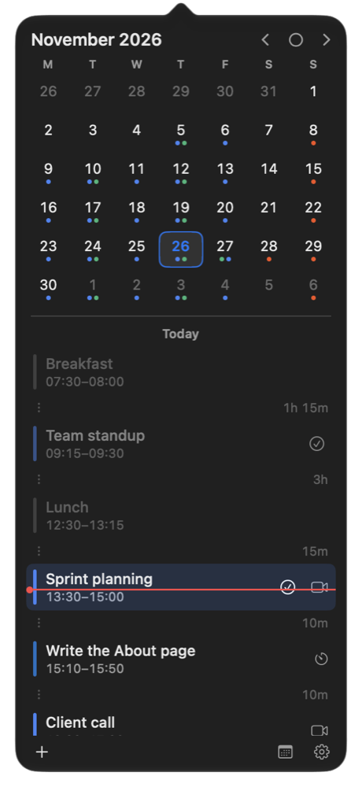

A small native menu bar app (Swift, no web engine) that shows the running task or appointment with the time left, or what comes next.

- Click it for a month view with dots per calendar and the day's list, with the free time in between and a red line at the current time.
- Click an entry to open its details next to the list: Join, Start, Pause, Done, Postpone, Pin.
- Right-click for quick actions: start, pause, done, break, lunch.
- A second, small item shows the date (TUE over 24) and can be placed on its own.
- It keeps one idle connection open and only redraws when something changes, so it uses very little battery.

Install it from the app (Settings → Devices & Access → Mac Menu Bar) or build it with `extras/macos/build.sh`. Details are [further down](#mac-menu-bar).

The menu bar app was inspired by [Calendr](https://github.com/pakerwreah/Calendr), an open-source menu bar calendar for macOS. If a calendar in the menu bar is all you need, have a look at Calendr.

<br clear="right">

## Quick start

```sh
git clone <this repository's URL> smart-calendar && cd smart-calendar
echo "APP_PATH=$PWD/store" > .env      # where the database and backups go (see .env.example for more)
docker compose up -d --build
cat store/data/SETUP-TOKEN.txt         # one-time token for creating the admin
```

Open `http://localhost:8097`, create the admin with the setup token, and the setup assistant connects your calendars. The port only listens on the machine itself, meant for a reverse proxy with https; for plain access in your network, remove `127.0.0.1:` from the port in `docker-compose.yml`. For a NAS with Portainer, a reverse proxy and Google sign-in, see [Install on a Synology NAS](#install-on-a-synology-nas-portainer) below.

# Documentation

## Security

- No open registration. On first start the container prints a one-time **setup token** (also in `data/SETUP-TOKEN.txt`), which you need to create the admin. After that the admin creates the other accounts.
- Passwords are hashed with scrypt. Login is rate-limited with an exponential lockout. Optional **TOTP 2FA** works with any authenticator app.
- Sessions use random 256-bit tokens, stored only as SHA-256 hashes. Cookies are `HttpOnly`, `SameSite=Lax`, and `Secure` behind https. A password change signs out other devices.
- CSRF: every state-changing API call needs a custom header, which cross-site forms can't send. CORS is not enabled.
- Strict CSP (no inline scripts, no third-party resources), HSTS, `frame-ancestors 'none'`, `nosniff`.
- Google refresh tokens, ICS links and Vikunja tokens are **encrypted at rest** (AES-256-GCM). The key is `APP_SECRET` or `data/app-secret`.
- The app runs as a non-root user. The start script only uses root to take ownership of the data folder, then drops privileges. The filesystem is read-only, all capabilities are dropped except the three the start script needs, and `no-new-privileges` is set. It listens only on `127.0.0.1` of the NAS, so the reverse proxy is the only way in.

## Install on a Synology NAS (Portainer)

1. In **DSM File Station**, create the folder `docker/smart-calendar` (= `/volume1/docker/smart-calendar`). The app creates `data` and `backups` in it. You don't need to set permissions: the container takes the folder over on start and then runs as an unprivileged user. If the log says the folder isn't writable, open the folder's Properties → Permission → add *Everyone: Read & Write*.
2. Portainer → **Stacks → Add stack → Repository**:
   - Repository URL: the address of this repository (or of your fork). For a private fork, turn on **Authentication** with your GitHub username and a **fine-grained token** with *Contents: read-only* on that repo only.
   - Reference: `refs/heads/main` · Compose path: `docker-compose.yml`
   - **Environment variables:** none needed. Optional: `APP_PATH` (default `/volume1/docker/smart-calendar`), `HOST_PORT` (default `8097`) and `TZ`.
   - Optional: turn on **GitOps updates** (polling) so a push to GitHub redeploys automatically. Enable *Re-pull image and redeploy* / *force rebuild* so the image is rebuilt.
3. Deploy. Portainer builds the image on the NAS from the repo.
4. Get the setup token from the container logs in Portainer, or from `data/SETUP-TOKEN.txt`.

Without Portainer: `cp .env.example .env`, fill it in, then `sudo docker compose --env-file .env up -d --build`.

### Backups

Every night (around 03:00) the server writes a complete copy of the database to the **backups** folder next to `data` (`/volume1/docker/smart-calendar/backups`) and keeps the last 30 days. Administration → Overview shows the last backup, has *Back Up Now*, and sets the folder, time and number of days. Another NAS path works too: add it to the volumes in `docker-compose.yml` at the same path (an example is there), then enter it in Administration. To restore after a problem: stop the stack, copy a backup over `data/smart-calendar.db`, start the stack. Keep the `data` folder too: it holds the encryption key (`app-secret`) the database needs.

Each user can also download their own data under Settings → Backup & Restore and restore it there (missing projects come back, nothing is duplicated).

### Reverse proxy (DSM → Control Panel → Login Portal → Advanced → Reverse Proxy)

| Source | Destination |
|---|---|
| HTTPS · `plan.example.com` · 443 · enable HSTS | HTTP · `localhost` · `8097` |

- Under **Custom Header**, click *Create → WebSocket* to add `Upgrade`/`Connection`.
- Set the timeouts to ≥ 300 s. Live updates use Server-Sent Events.
- Certificate: Control Panel → Security → Certificate → Let's Encrypt for `plan.example.com`, assigned to this reverse-proxy entry.
- If the NAS terminates TLS somewhere other than localhost, set `TRUST_PROXY` to that proxy's IP.

**LAN only** also works: drop `127.0.0.1:` from the port line in `docker-compose.yml` and set `BASE_URL=http://nas:8097`. Without https, though, browsers block push notifications and the PWA install, and Google sign-in won't accept the redirect URL. Sync and planning work the same either way, because they run on the server.

### Google Calendar (admin once, then every user by themselves)

**Admin, once:** open **Settings → Server** in the app. It walks you through five steps in Google Cloud (create a project, enable the Calendar API, consent screen, client) and shows the exact redirect URI to paste there. Then paste the client ID and secret into the app. Publish the consent screen (**In production**); in *Testing* mode Google signs everyone out after 7 days.

**Every user:** on first login the **setup assistant** opens:
1. **Sign in with Google** → **Allow**. Because the app is private and unverified, Google first shows *"Google hasn't verified this app"*: click **Advanced → Go to plan.example.com**. A calendar named **Smart Calendar** is created automatically, and your plan goes there.
2. Tick which of your calendars block your time, and optionally paste your Outlook/Exchange ICS link.
3. Pick when you do chores (evenings + weekends, weekends only, …).
4. Turn on reminders. On iPhone, first use *Share → Add to Home Screen*.

Shared projects: each task lands in the **assignee's own** Smart Calendar, and with "take turns" the person alternates each round. To show the Smart Calendar in Apple Calendar on iPhone/Mac, tick it once at <https://calendar.google.com/calendar/syncselect>.

The `GOOGLE_CLIENT_ID`, `GOOGLE_CLIENT_SECRET` and `BASE_URL` environment variables still work and override the in-app values.

### Exchange (Outlook)

Outlook on the web → ⚙ Settings → Calendar → **Shared calendars → Publish a calendar** → your calendar, "Can view all details" → Publish → copy the **ICS** link. Paste it under Settings → Exchange. Busy, OOF and tentative events block; "Free" events don't.

### Vikunja

Vikunja → Settings → **API Tokens** → new token with *tasks: read all, update*, *projects: read all*, *user: read* and every *webhooks* permission (for live updates). Paste the URL and token under Settings → Vikunja. The server adds a webhook to each project it reads; Vikunja must be able to reach `https://plan.example.com` (it refuses private addresses, so that name must resolve to the public address from the Vikunja server).
Duration comes from a label (`30m`, `2h`, `1.5h`) or a line like `est: 90m` in the description, otherwise from the default. Priority maps as DO NOW/urgent → ASAP, high → High, and so on. The due date becomes the deadline.

Per account in Settings → Calendars:
- **Assigned to:** only tasks assigned to this Vikunja username. Without one, the user the token belongs to is used; an API token can't ask Vikunja for its user, so it is guessed from who owns most projects.
- **Plan automatically:** off, and the tasks are still in their projects and views but not planned.
- **Start, Pause and Done:**
  - Start puts a task in its Kanban's *In Progress* bucket (also *Doing* or *In Arbeit*) and writes the session into the calendar while you work.
  - Pause cuts that entry to the real end and leaves the task in In Progress; the next Start adds a new entry.
  - Done ends it and moves the task to the done bucket.
- **Calendar:** where its blocks and sessions go, e.g. a team calendar. There they're titled with your tag (*Your tag* under Plan): "JD - Order nozzles", and "JD - ✓ Order nozzles" once done.
- **Projects (›):** per Vikunja project, *Sync* (off: the project and its tasks are gone here, menu included) and *Plan*.

**Files.** Tasks in a Kanban bucket called *Dokumente & Infos* (also *Dokumente*, *Files*, *Dateien*, *Infos*) are folders, not work: they aren't planned. On a Vikunja project's page, the folder button at the top right shows that project's attachments, by folder. A click previews PDFs, images, text, audio and video in the app, with *Open* (new tab) and *Download*; other files download. Files come through the server from Vikunja (with the sign-in page's session where needed), and only those of the folders shown can be fetched. An attached HTML or SVG file always downloads and never runs as part of the app.

## Household

- **Locations.** Give chores a location (Basement, Kitchen, …). When one task at a location is planned, other due tasks at the same place are scheduled right after it. The wall display lists them as *Also in Basement*.
- **Follow-ups.** In a task's *More Options → Then*, add steps that are created when the task is done, either after a delay or when an event arrives. Example: *Start washer* → then *Move laundry to dryer* when `washer_done` (or after 120 min) → then *Fold laundry*.
- **Wall display.** Switch on *Wall display* in the shared chores project's settings. Administration → Displays → New Display, then open the link on the tablet (or use Home Assistant). It shows a button for every member of that project, the current task with Done/Later, tasks grouped by room, waiting follow-ups and what's done today: only the tasks of that project. It is the one place where everyone sees everyone's tasks.

### Home Assistant

The integration lives in its own repository: **[ha-smart-calendar](https://github.com/Esondor/ha-smart-calendar)**.

[](https://my.home-assistant.io/redirect/hacs_repository/?owner=Esondor&repository=ha-smart-calendar&category=integration)

Install through HACS: the button above, or HACS → *Custom repositories* → `https://github.com/Esondor/ha-smart-calendar`, category *Integration*. Then go to Settings → Devices & Services → Add *Smart Calendar*:
- **Address:** `https://plan.example.com`
- **Access token:** Smart Calendar → Settings → Access Tokens
- **Display link** (optional): Administration → Displays. This adds a **Chores** panel to the HA sidebar.

In Smart Calendar → Administration → Displays → *Home Assistant address*, enter every address you open HA with (e.g. `http://homeassistant.local:8123`, `https://ha.example.com`). Only those may embed the wall display.

Automation when the washer is done:
```yaml
action: smart_calendar.event
data: { name: washer_done }
```
Sensors: *Next task*, *Open tasks* and *Waiting* (each with attributes). Service `smart_calendar.complete` takes a `task_id`.
Without HACS, use a *Webpage* dashboard or card with the display link, or a `rest_command` that POSTs `/api/ext/event/washer_done` with `Authorization: Bearer <token>`.
On a wall tablet you can point Fully Kiosk directly at the display link.

### Mac menu bar

`Smart Calendar Bar` is a small native menu bar app, inspired by [Calendr](https://github.com/pakerwreah/Calendr). The bar shows what Now shows: the running task or appointment with the time left (`Design Sync · 15 min left`, `+8 min` once it runs over), otherwise what comes next (`Team Standup in 18 min`, `14:00 Dentist`).

**Left click** opens a panel:
- **Month:** a dot for each calendar with something on that day. Click a day to see it.
- **Day list:** every entry has its calendar's colour as a band and a dot for each calendar it is copied into. For today it shows the free time in between, and a red line at the current time, inside the running entry as far as it has got.
- **Detail:** click an entry for when, calendars, place, notes, Join, Start/Pause, Done and Postpone. A planned task or flexible appointment can be pinned at its time (Pin) or handed back to the planner (Unpin); a fixed appointment can become a flexible one (Make Flexible).
- **Date:** a second, small item shows the day and date (TUE over 24) and opens the same panel and menu. Move each item on its own with ⌘-drag. When there's nothing to show, the appointment item hides and the date stays. Turn it off under Settings → Menu Bar → Date.
- **+** (bottom left, or New in the right-click menu): a task, an appointment or a flexible appointment, as with + in the app.

By default the bar shows what Now shows: appointments that block time, without hidden ones or filtered-out group events. Settings → Shown can leave calendars out or show appointments that don't block time; Settings also has the text size and the calendar color.

**Right click** opens the quick menu with the Now buttons, and Settings (menu bar display, calendar, account, Open at Login, Quit).

The quick menu has these buttons:
- **Tasks:** Start, Pause, Done, 30 More Minutes, Postpone, Skip.
- **Track an appointment:** an appointment you're in (blocked time too) has *Start*, *Pause* and *Done* in Now and in its details, like in the menu bar. Tracked past its end, it keeps its time and gets 30 more minutes each time, until you press Done.
- **Google matches Smart Calendar:** what you drag, start, pause or extend here shows the same in Google at once, also a tracked appointment's longer end. Whatever you worked on stays in both as the log, marked ✓ and cut to when you worked. A block that came and went without being started is just planned again; nothing is logged.
- **Pause:** what you did so far is logged right away and the task stays in Now as *Paused*. Resume within 10 minutes and it carries on as one session; after that, the part before stays as its own entry and Resume starts a new one. *Stop* lets the paused task go.
- **Start from the planned time:** forgot to press Start? *Start from 14:00* counts from when the block was planned. The block runs to its planned end plus 30 minutes and gets 30 more each time that's reached, until you press Done.
- **Free time:** Break, Lunch.
- **Appointments:** Join, Start, Pause and Done.
  - Start (from an hour before) gives it its real start: it moves to now in Google with the same length (the buffer takes up the rest), and what is flexible around it is planned again. Resuming after a pause changes nothing. A read-only calendar keeps its time; Smart Calendar plans with the real start.
  - Done, once it has started, gives it its real end: *Ended Now*, *Other Time…*, or *Ended as Planned* once that time has passed. Earlier or later than planned, the end moves in Google and what is flexible after it is planned again. A read-only calendar (Exchange) keeps its time; Smart Calendar plans with the real end.
  - **Earlier** lists today's appointments that have ended but aren't marked done.

**Install:** Settings → Devices & Access → Mac Menu Bar (shown on Macs).
1. **Download**, open the disk image and drag the app to Applications.
2. Open it. The app isn't signed by an Apple developer, so macOS blocks it the first time. Go to System Settings → Privacy & Security → *Open Anyway*.
3. **Connect this Mac** creates a token and hands it to the app with the address. The app asks before it connects and turns on Open at Login.

Each person installs it on their own Mac with their own account. Revoking the "Mac menu bar" token in Access Tokens cuts that Mac off.

**Build:** `extras/macos/build.sh` installs into `/Applications`. Use `build.sh --dmg` to write the installer the server hands out (`public/mac/SmartCalendarBar.dmg`, for Apple Silicon and Intel). Only the Command Line Tools are needed. After a rebuild, macOS may ask once whether the new build may read the token in the keychain: choose *Always Allow*.

**Battery:** the app has no web engine and no polling loop. One idle connection to `/api/ext/stream` says when the plan changed, and only then is the agenda fetched. The label is redrawn only when its text changes. Nothing runs while the display sleeps. In Low Power Mode it fetches every 15 minutes instead. The stream sends a keep-alive line every 50 s, which the default 60 s proxy timeout allows.

### Claude

Each user can let their own Claude account read and change their projects: Settings → Claude → Allow Claude, copy the URL (`https://<your domain>/mcp`), and add it in claude.ai under Settings → Connectors → Add custom connector. Claude opens this server's sign-in and asks you to allow it. After that, a chat can, for example, read your thesis draft and bring the outline in line with it: Claude shows the list of changes first and applies them only after you agree; the last batch can be undone.

- Off for everyone until they turn it on themselves; turning it off disconnects at once. Connections are listed there and can be removed one by one.
- The server stores nothing about Claude. Each user signs in with their own Claude account, and a connection only reaches that user's projects.
- Only Claude's own callback (or a loopback address, for Claude Code / Claude Desktop) can receive a sign-in; access tokens last an hour, refresh tokens 60 days and rotate.
- The reverse proxy must pass `/mcp`, `/oauth/` and `/.well-known/` to the app, which it does when the whole domain points to it.

## Sign-in

Passkeys (Face ID / Touch ID) are the default sign-in. Add one under Settings → Account → Passkey. Passwords remain as a fallback. A passkey also counts as a second factor for the 2FA policy.

## Google verification

For a private app the consent screen only needs to be **published** (Audience → *In production*). Verification is **not required**: up to 100 users can sign in after confirming Google's "unverified app" notice. The message *"Your app requires verification"* and the branding issues only mean your logo and name aren't shown on the consent screen.
If you still want branding verification:
1. Verify `example.com` in [Google Search Console](https://search.google.com/search-console) (DNS TXT record), then wait 24 h.
2. Set Homepage = `https://plan.example.com/about` and Privacy policy = `https://plan.example.com/privacy`. These public pages are built in; set the contact e-mail under Administration → Server. Authorized domain = `example.com`.
3. The app name must be exactly **Smart Calendar**.

## Calendar rules

- **Calendar per project:** Project → ⚙ → *Calendar*. Pick one of your calendars or *New Calendar*, and that project's blocks go there instead of the main plan calendar. Planning is unchanged, so you can hide the calendar in Google or Apple Calendar to tidy the view. This setting is per person. Settings → Plan lists every project with its calendar.
- **Shared project calendar:** in a shared project, pick a calendar and tick *Shared*. The app gives the other members write access to that Google calendar and adds it to their accounts, so everyone's blocks for the project land in the same calendar, each with the person's name. Members need a connected Google account. Your main calendar can't be shared this way.
- **Travel and blocked time:** tap a Google or Exchange event in the app calendar and set *Before* and *After*. That time blocks the planner and shows as a dashed outline. For a repeating event it applies to every occurrence. An event with travel time always blocks, even if a keyword filter would let it through.
- **Moved blocks:** a block you move (here or in Google) stays put. Tap it in the app calendar → *Auto-schedule* (or *Auto-schedule* in the task) to hand it back to the planner. This also undoes a postpone.
- **Keep order** (Project → ⚙): tasks start only after the one before them is finished, in the project's order. On by default for outline projects, off for boards, where the planner only makes sure deadlines are met.
- **Filtered copy:** Settings → Calendars → arrow next to a calendar with keyword filters → *Filtered copy*. The app creates a Google calendar (e.g. “Group calendar filtered”) and keeps only the events that pass the filter in it. Hide the full calendar in Google/Apple Calendar and show the copy instead.
- **Refresh:** pull down at the top of a page to sync all calendars now.
- **Keyword filters per calendar** (Settings → Calendars, arrow next to a ticked calendar): *Mine* (e.g. `JD`) and *Others* (e.g. `AD, PE, DM, WW, Robin`). An event with one of your words always blocks, even if others are named too (“JD, AD – Meeting”). An event with only other people's words does not block (“AD – Meeting”). Everything else blocks too, so oddly named events (“Meeting”) are not missed; tap such an event in the app calendar to switch it off. *Only mine* limits blocking to events with your words. Words match whole words and ignore case; put a word in quotes (`"JD"`) to match exact case.

- Timed events block unless they're set to *Free* or have `/hide` or `/free` in the title or notes. `/block` makes an event block even when it's set to Free. Typed into the title of one of your Google events, `/block` and `/free` are moved out of the title into the notes, and the event is set to Busy or Free. Works from any calendar app; the filtered copy leaves them out too.
- **Flexible appointments.** A task can have a window under *Between* (e.g. Mon–Fri 08:00–11:00, a practice's opening hours). It's planned in one piece, as soon as possible, inside the window: right next to another appointment if one touches it, otherwise about an hour before closing, not first thing in the morning. In any calendar app, type `/flex 30` into an event spanning the opening hours: it becomes such a task (30 min, window = the event's time) and the event is replaced by the planned block. `/task` (or `/task 45`) makes a normal planned task. In an event's sheet, *Auto-schedule* does the same. Marked done, a flexible appointment stays in its calendar as a normal appointment with its place and notes. It keeps its planned time if that had begun (cut off at the moment you mark it done); otherwise it ends at the moment you mark it done.
- **+ menu.** *Task*, *Appointment* (fixed, in a calendar you choose) or *Flexible Appointment* (takes …, between … and … on chosen weekdays, from a date, written to the calendar you choose, e.g. one shared with your partner). The app's own entries carry a marker, so a calendar that also counts as busy never reads them back.
- **Places and travel time (Google Maps).** With a Maps key (Administration → Server → Google Maps: enable *Places API (New)* and *Routes API*, create an API key), every place field suggests places while you type, nearest to your home first (Settings → Planning → Home), and fills in name and address. Below it you see the time by car and by bike; in an event a tap sets the travel time before and after, in a flexible appointment the planner keeps it free around the visit. The key stays on your server.
- **The way there as the buffer.** With a home address (Settings → Planning → Travel → Home), every blocking appointment at a place in the next two weeks gets the way from home as its buffer before it. It goes by bike when that takes at most *By bike up to* (25 min by default), otherwise by car. It's never shorter than *Buffer around events*. Online meetings (a link, Teams, Zoom …) get none. After the day's last appointment at a place you travel to, the way home follows as a buffer too. A later appointment at the same place gets no second way there; you're still there. Loose breaks move off the way home and can't use it. A bike or car icon marks these buffers in the calendar, Now shows when to leave, and so does the menu bar. Times are kept per place for 30 days and measured again when your home changes. *Places* (same section) turn room codes into the place you go to. For example, `B## #-###` → North Campus matches B03 1-161, B03-1-161 and B3-1-161 in an event's place or title, unless the event's place is already an address (a street with a number, or a postcode). In a pattern, `##` means up to two digits, a space or `-` matches either or none, `*` matches anything; `/…/` is a regular expression. The place can be an exact pin: pick a suggestion, or paste a Google Maps link (also a short `maps.app.goo.gl` link) or coordinates (`48.13743, 11.57549`). The way is then measured to the pin, and matching events get a link that opens it in Google Maps, in the app's event sheet and in the menu bar. A buffer you set yourself in an event wins.
- **Flexible appointments** go to their own *Appointments* project and are written to the calendar you chose for them (no main plan calendar needed).
- **Also in …** In an event's sheet, copy it into other calendars of yours so the people there see it too. The copies are linked: Smart Calendar shows the appointment once, with dots in the colors of the other calendars, and never takes them for a clash.
- **Now** shows the appointment you're in (or the next one) at the top, with place and *Join*, without a timer.
- **Calendar on the phone** scrolls up and down only; a clear sideways swipe changes the day; pinch with two fingers to see more or less of the day.
- **Commands** are listed in Settings → Commands.
- **Loose and firm breaks.** Fixed times (breakfast, lunch …) are *Loose* by default: an appointment or an ASAP task may take their time, then the break moves up to an hour earlier or later, and only gives way if there's no room. That includes calendar appointments: a break on one moves off it. A break up to an hour away from an appointment moves right next to it, so no short gap is left between them. It may use the default buffer after a meeting, but not travel time or a buffer you set. A break that has begun stays put. *ASAP* breaks stay where they are, and only ASAP tasks may move them. *Firm* breaks never move.
- **Meals and ASAP tasks.** Breaks named Breakfast, Lunch or Dinner (also Frühstück, Mittag, Abendessen) follow their own rules when an ASAP task needs the time. Breakfast or lunch may be left out, but never both on the same day. Dinner is never left out, but it may move up to 2 hours later.
- **Task reminders don't pile up.** While you don't start a task, the plan keeps moving it, but its *starts soon* reminder comes at most three times a day, 30 minutes apart.
- **Ranking of calendars.** Settings → Calendars → Ranking: drag your blocking calendars and *Tasks* into order; higher wins. Tasks are only kept out of calendars ranked above *Tasks*, a clash goes to the higher calendar, and an event moved to a new time only has to avoid its own calendar and those above it.
- **Missed appointments.** On *Now*, tap an entry and tap it again (clashes can be decided there too, and in the *Clashes* list, with *Choose*): change the title, day and time, or move it (next free time, tomorrow, next week). An event can be given *Times*: a start and end on chosen weekdays (e.g. Mon–Fri 08:00–11:00), or a named set from Planning → Hours; it's then only moved into those times. Each event also has its place in the *Ranking*: automatic (in your work hours its calendar's rank; outside them your own events come first and group events drop below your calendars), and you can drag it in the event's sheet; *Auto* resets it. A task like cat feeding gets its times the same way, under *Hours* in the task.
- **Clashes with the group calendar.** When an event of a group calendar (one with *Only with* words) that concerns you overlaps one of your own blocking events, you get a push right away with one button per event. On the *Now* page, under *Clashes*, you can change it later. Until you decide, the calendar ranked higher wins, unless your holiday (e.g. `JD Holiday`) is on that day; then your own event wins. When your own event wins, `#JD-blocked` is written into the group event's notes so the others see you can't come, and it's taken out again if you change your mind or the clash goes away. Your tag (`JD`) is set in Settings → Plan; by default it's the first *Only with* word. The same appointment kept in two calendars (similar title without your tag, start and end within 15 minutes) is not a clash; for anything not recognised, *Same Appointment* on the clash keeps both and writes no note. *Dismiss* keeps your choice and doesn't ask again. Writing the note needs a Google group calendar you may edit; an Exchange (ICS) link is read-only.
- All-day events and events over several days block when set to *Busy* or marked `/block`. Settings → Plan can make each of them always block or never block. The choice on a single event still wins.
- Blocks the app writes itself never block.

## Demo website

`npm run demo` builds `demo-site/`: the real web app with invented people, calendars and projects, and no server behind it. The server runs once during the build and records every page; in the browser, `demo.js` answers the app's requests from that recording, moved to the current week. Visitors can click through everything; what they change (tick off, edit, add, start a timer) stays until they reload. Nothing is sent anywhere.

It is a plain static site, so any static host works. **Cloudflare Pages** (free, also for private repos): *Workers & Pages → Create → Pages → Connect to Git*, pick this repository, then
- Build command: `npm ci && npm run demo` · Build output directory: `demo-site`
- Environment variable: `NODE_VERSION` = `24`

Every push to `main` rebuilds it. The demo shows the plan as of its build day, so rebuild it daily (a Cloudflare *Deploy hook* called once a morning) to keep "today" right.

## Development

```sh
npm install
npm run dev          # http://localhost:8080 (data in ./data)
npm test             # scheduler, Google round-trip (mocked API), Vikunja round-trip
```
Stack: Node 24 (built-in `node:sqlite`), Fastify, web-push, node-ical. The frontend is Preact + htm as plain ES modules, with no build step.

## License

Smart Calendar is **free for non-commercial use** under the [PolyForm Noncommercial License 1.0.0](LICENSE.md): personal use, hobby projects, study and research, schools, charities and public institutions may use, change and share it. Commercial use is not covered; if you would like to use it in a company or offer it as a service, open an issue and ask about a commercial license.

Its libraries (Preact, Fastify and others) keep their own licenses. The Mac menu bar app is inspired by [Calendr](https://github.com/pakerwreah/Calendr).
